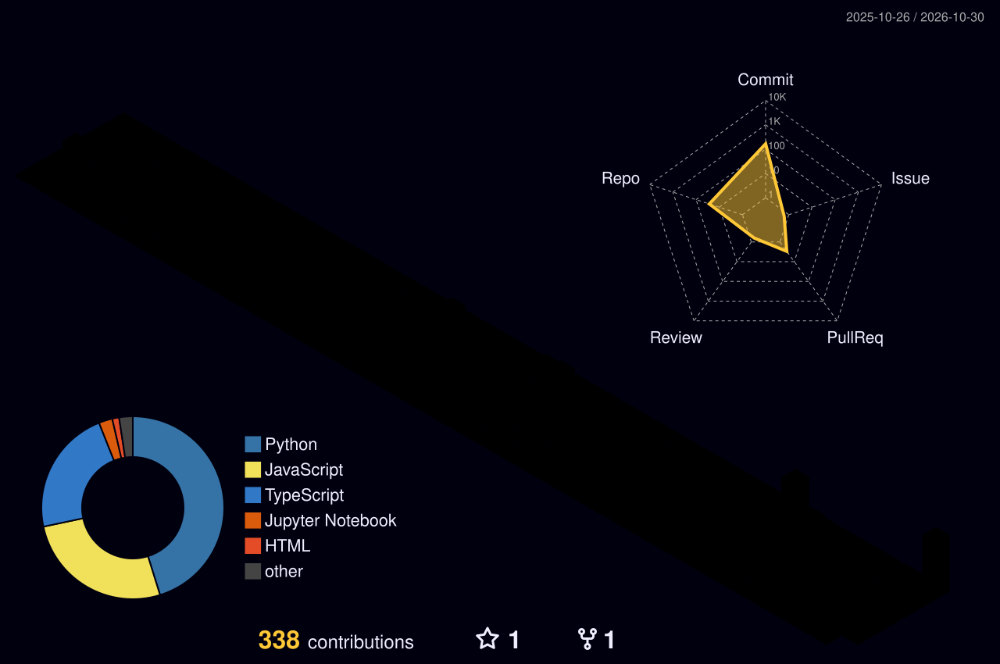

<!-- ═══════════════ HEADER ═══════════════ -->
<div align="center">



<a href="https://git.io/typing-svg">
  
</a>

<br/>

<a href="https://shermaineyap.vercel.app"></a>
<a href="https://www.linkedin.com/in/shermaineyapshimin/"></a>

<a href="https://github.com/ShermaineYap?tab=followers"></a>

</div>

<!-- ═══════════════ ABOUT ═══════════════ -->
##  `whoami`

```python
class Shermaine:
    def __init__(self):
        self.role        = "Data Analyst × AI Builder"
        self.education   = "Asia Pacific University (APU), Malaysia"
        self.location    = "Kuala Lumpur 🇲🇾"
        self.personality = "ESFJ-A ✨"
        self.focus = [
            "Data Analytics & Visualisation",
            "AI Agents & LLM Apps",
            "Deep Learning & Optimisation",
            "Database Security (SQL Server)",
        ]
        self.currently_doing = [
            "Microsoft Power BI Data Analyst Certificate",
            "GCI World — UTokyo Matsuo-Iwasawa Lab",
            "Building at hackathons, one weekend at a time",
        ]

    def motto(self):
        return "Raw data in. Meaningful insights out. 📊"
```

<!-- ═══════════════ NUMBERS ═══════════════ -->
<div align="center">


</div>

<!-- ═══════════════ TECH STACK ═══════════════ -->
## ⚡ Tech Stack

<div align="center">


<br/>

<br/>


<br/><br/>


</div>

<!-- ═══════════════ PROJECTS ═══════════════ -->
## 🛰️ Featured Builds

<div align="center">

<a href="https://github.com/ShermaineYap/jaga"></a>
<a href="https://github.com/ShermaineYap/glitchgym"></a>
<a href="https://github.com/ShermaineYap/sopan"></a>
<a href="https://github.com/ShermaineYap/squadro-match-lab"></a>
<a href="https://github.com/ShermaineYap/ai4alzheimers-hackathon"></a>
<a href="https://github.com/ShermaineYap/AssemblyAI-Voice-Agent-Hackathon"></a>

</div>

<!-- ═══════════════ HACKATHONS ═══════════════ -->
## 🏆 Hackathon Arena

<details open>
<summary><b>Click to expand / collapse my hackathon builds</b></summary>
<br/>

| Build | Event | Stack |
|:--|:--|:--|
| 🛡️ [**Jaga**](https://github.com/ShermaineYap/jaga) | NVIDIA Nemotron · Nebius | Python |
| 🐞 [**GlitchGym**](https://github.com/ShermaineYap/glitchgym) | Glitchathon 2026 (Build with AI) | Python |
| 🧕 [**Sopan**](https://github.com/ShermaineYap/sopan) | YouCam API virtual try-on | TypeScript |
| 🏸 [**Squadro Match Lab**](https://github.com/ShermaineYap/squadro-match-lab) | AQX Sports Analytics Data Bowl 4.0 | Python |
| 🧠 [**AI4Alzheimers**](https://github.com/ShermaineYap/ai4alzheimers-hackathon) | AI4Alzheimers Hackathon | Jupyter |
| 🎙️ [AssemblyAI Voice Agent](https://github.com/ShermaineYap/AssemblyAI-Voice-Agent-Hackathon) | AssemblyAI Voice Agent Hackathon | JavaScript |
| ☁️ [AWS Zero To Shipped](https://github.com/ShermaineYap/AWS-ZeroToShippedHack) | AWS Zero to Shipped | JavaScript |
| 📦 [Swaddle](https://github.com/ShermaineYap/Swaddle-AmazonDevHack) | Amazon Dev Hack | Python |
| 🔵 [IBM Bob 2](https://github.com/ShermaineYap/IBM-BOB2-HACK) · [Mini Bobathon](https://github.com/ShermaineYap/IBM-MINI-BOBATHON) | IBM | JavaScript · HTML |
| ⛓️ [HazeChain](https://github.com/ShermaineYap/hazechain-IEEEHack) | IEEE Hack | JavaScript |
| 👁️ [OpenCV AI Hack](https://github.com/ShermaineYap/OpenCV-AI-Hack) | OpenCV AI | Python |
| ✨ [Build with AI](https://github.com/ShermaineYap/Build-with-Ai-Hack) | Build with AI | TypeScript |
| 💸 [Finance AP Command Center](https://github.com/ShermaineYap/finance-ap-command-center-Scuba67) | Autopilot Round 2 | TypeScript |
| 🛠️ [Taskforge](https://github.com/ShermaineYap/Taskforge-Hack) · [NextSpark](https://github.com/ShermaineYap/NextSpark-Hack) · [WeAreDevelopers × BAND](https://github.com/ShermaineYap/WeAreDevelopers-x-BAND) | Various | Python · JavaScript |

</details>

<!-- ═══════════════ LEARNING ═══════════════ -->
## 📜 Certifications & Learning

<div align="center">


</div>

<!-- ═══════════════ STATS ═══════════════ -->
## 📡 GitHub Telemetry

<div align="center">


</div>

<!-- ═══════════════ 3D CONTRIB ═══════════════ -->
## 🧊 3D Contribution Skyline

<div align="center">

</div>

<!-- ═══════════════ SNAKE ═══════════════ -->
## 🐍 Contribution Snake

<div align="center">
<picture>
  <source media="(prefers-color-scheme: dark)" srcset="https://raw.githubusercontent.com/ShermaineYap/ShermaineYap/output/github-contribution-grid-snake-dark.svg" />
  <source media="(prefers-color-scheme: light)" srcset="https://raw.githubusercontent.com/ShermaineYap/ShermaineYap/output/github-contribution-grid-snake.svg" />
  
</picture>
</div>

<!-- ═══════════════ FOOTER ═══════════════ -->
<div align="center">


</div>
